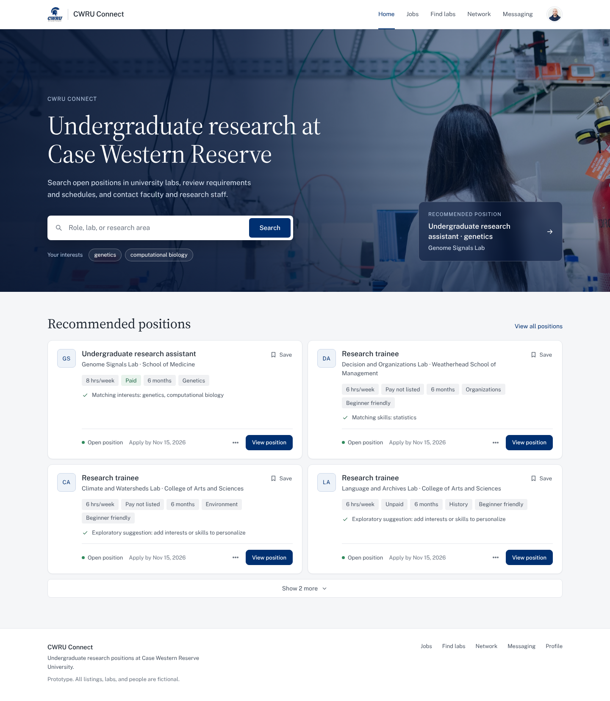

# CWRU Connect

A local recruiting-site prototype for Case Western Reserve University students to discover research opportunities, explore labs, and find research contacts.



## Features

- **Home:** landing page and recommended research openings.
- **Jobs:** searchable postings, availability and compensation filters, saved roles, and opening details.
- **Find labs:** a broader searchable lab directory.
- **Network:** research contacts and recruiting details.
- **Messaging:** an inbox empty state linking to the network.
- **Profile:** photo avatar, editable About, Hard skills, Interests, Education, research preferences, and resume attachments.

About edits and saved-item preferences persist in browser storage. PDF and DOCX resumes up to 5 MB can be added, replaced, downloaded, and removed; files remain in IndexedDB on the current device.

## Run locally

Requires Node.js 20 or later. No dependencies, API keys, or database setup are needed.

```sh
npm run demo
```

Open [localhost:4173](http://127.0.0.1:4173/). The server binds to this computer only. Set `DEMO_PORT` to use another port.

## Verify

```sh
npm run validate
npm run verify:docs
```

The simulation validator checks 131 invariants against fictional fixtures. The documentation check verifies coverage of 51 PRD requirements and the integrity of the original source snapshot. These checks do not replace browser or production acceptance testing.

## Prototype scope

All students, labs, contacts, and openings are fictional. The simulation uses a fixed October 27, 2026 reference date. The site does not authenticate users, submit applications, send messages, or upload resumes to a server. It is an independent prototype, not an official university recruiting service.

## Project structure

- `demo/`: dependency-free HTML, JavaScript, one stylesheet (`site.css`), and local assets.
- `data/simulation/`: fictional fixtures, generator outputs, and validation reports.
- `scripts/`: local server, fixture generation, and verification tools.
- `docs/`: planning, requirement traceability, and design/verification records.
- `artifacts/showcase/`: saved interface previews.

## Documentation

- [Profile redesign and verification](docs/design/profile-redesign.md)
- [Latest visual polish](docs/design/unslop-polish-report.md)
- [Home and navigation implementation](docs/design/cwru-connect-home.md)
- [Implementation plan](docs/implementation-plan.md)
- [Requirements map](docs/requirements-map.csv)
- [Simulation dictionary](data/simulation/README.md)

`DESIGN.md` and older reviews document earlier iterations. [Professional makeover](docs/design/professional-makeover.md) describes the current interface.

## Assets and credits

CWRU Blue is `#003071`. The landing-page lab photo is by ThisisEngineering on Unsplash (Unsplash License). The Spartan logo is sourced from CWRU Athletics; the generic avatar is sourced from Random User Generator and does not identify the fictional profile owner. [Asset provenance](docs/design/branding-assets.md) records the original sources. Institutional marks remain the property of their owners; this repository does not establish institutional authorization or endorsement.

Public Sans and Source Serif 4 are self-hosted under the SIL Open Font License ([Public Sans](demo/assets/public-sans-license.txt), [Source Serif 4](demo/assets/source-serif-4-license.txt)).

Design method: [Unslop](https://github.com/heydamir/unslop) by Damir Sokolovsky (@heydamir), CC BY 4.0. No broader license is asserted for third-party assets or the rest of this repository.
